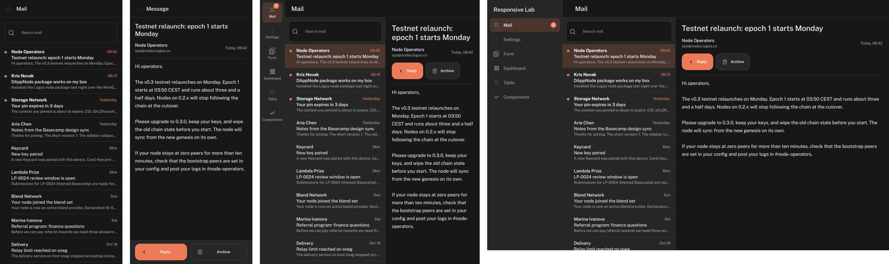
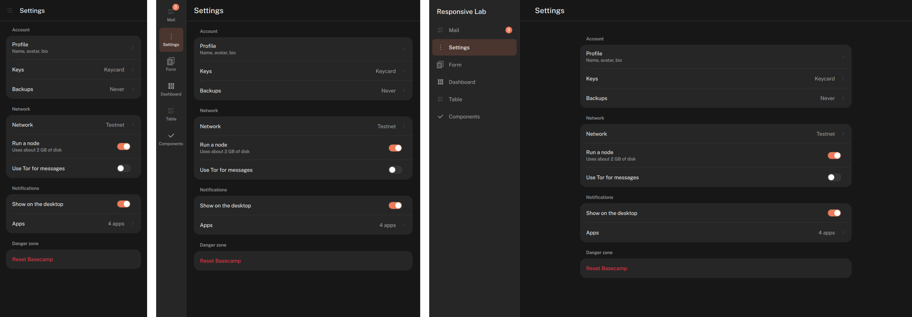
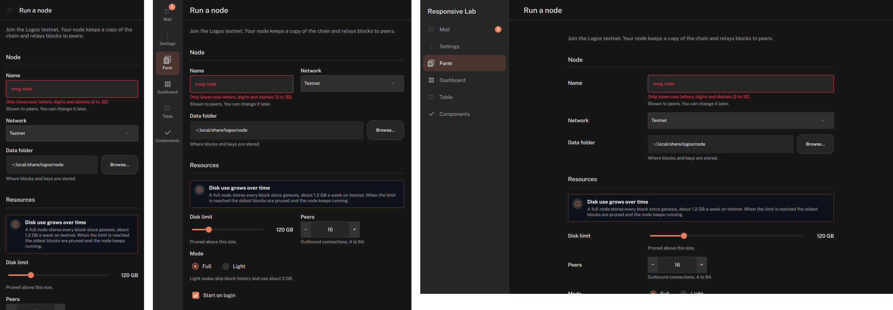
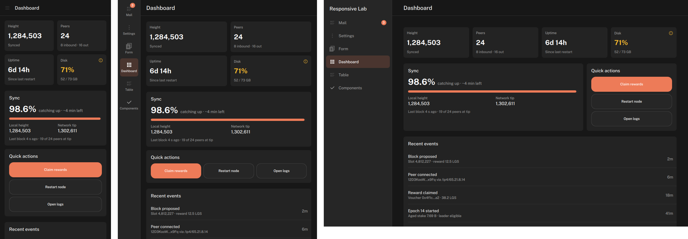
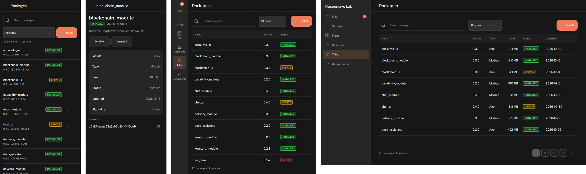
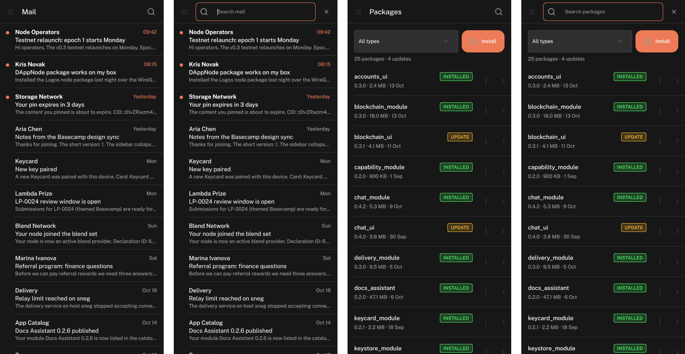
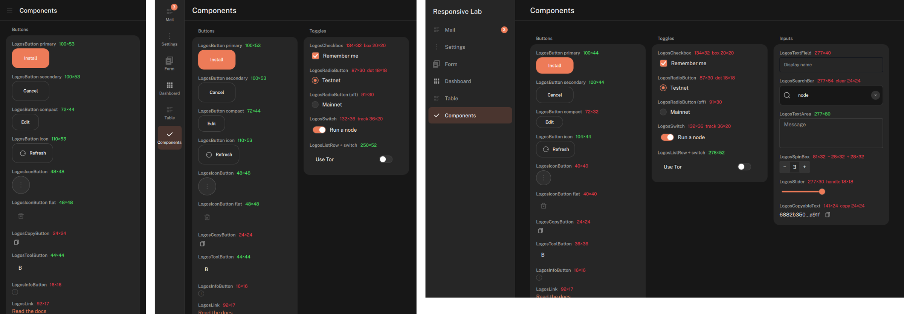

# Responsive layout: rules for Logos apps

Status: draft, 2026-10-22 (`feat/responsive`). Proven in the **responsive lab**
(`responsive-lab/`), where every rule below is rendered at 390, 700 and 1280 px and checked.

## TL;DR

- Decide layout by the **width of your app's area**, never the screen: `Theme.windowClass(width)`
  gives `compact` (< 600), `medium` (600–839) or `expanded` (≥ 840).
- Wrap the app in **`LogosAppScaffold`**: sidebar when expanded, icon rail when medium, ☰ drawer
  when compact, and a back chevron instead of ☰ when a page has pushed a detail.
- On touch, everything tappable has a **44 × 44 hit area** (`Theme.minTouchTarget`); the visual
  may be smaller. Use `--density touch` to check.
- **Nothing is hover-only or double-click-only.** Tooltips are extra, never the only place a
  piece of information or an action lives.
- **Prove it:** render at 390 / 700 / 1280 with the lab's shot mode; overflow and small targets
  must be empty.

## 1. Window classes

| Class | Width of the app area | Typical | Navigation | Columns |
|---|---|---|---|---|
| `compact` | < 600 | phone, narrow window | ☰ drawer (or back ‹ on a detail) | 1 |
| `medium` | 600 – 839 | tablet portrait, half screen | icon rail (80 px) | 1–2 |
| `expanded` | ≥ 840 | desktop, tablet landscape | sidebar (240 px) with labels | 2–3 |

Tokens: `Theme.breakpoints` (`medium: 600, expanded: 840, large: 1200`), `Theme.windowClass(w)`,
`Theme.pageMargin(w)` (16 / 20 / 40), `Theme.minTouchTarget` (44).

Rules:
1. Bind to the class, not to pixel checks scattered through the file:
   `readonly property string windowClass: Theme.windowClass(width)`.
2. Measure your own `width` (the content area), so the same page works inside Basecampium's
   compact shell, a split view, or a torn-off window.
3. Between classes the layout changes; within a class it only stretches. Cap reading width:
   text columns and forms stop at ~720 px and centre.

## 2. App frame: `LogosAppScaffold`

```qml
LogosAppScaffold {
    title: "Mail"                       // app name: sidebar and drawer header
    pageTitle: page.title               // top bar
    navModel: [{ id: "inbox", label: "Inbox", icon: LogosIcons.list, badge: 3 }, …]
    currentNav: current
    canGoBack: page.canGoBack           // compact: ‹ replaces ☰
    onNavActivated: id => current = id
    onBackRequested: page.goBack()
    actions: [ LogosIconButton { iconSource: LogosIcons.search } ]
    Loader { id: page; anchors.fill: parent; … }
}
```

- 3–7 top-level destinations. More than that: group them, or move some into Settings.
- Labels stay short (one word fits the rail).
- The drawer closes after a choice, and closes itself if the window grows out of compact.
- **Hosted screens don't nest a scaffold.** A screen the shell already frames (a Basecamp tab,
  Settings) uses list → detail instead: compact = the list is the page, a tap pushes the detail
  under a 44 px "‹ Parent" row. Proven on Basecamp's Settings.

## 3. Patterns

(Each pattern: what it does per class, and the lab screen that proves it.)

### 3.1 List → detail (mail, chat, any inbox) · lab: `mail`



- **medium / expanded:** two panes. List fixed at 320 (medium) / 360 (expanded) on
  `backgroundSecondary` with a 1 px `borderSubtle` edge; detail fills the rest. The detail always
  shows something (the first item by default); the open row uses `listItem.backgroundSelected`.
- **compact:** one pane. Tap a row → the detail full width; the page sets `canGoBack` and the
  scaffold shows ‹; back returns to the list at the same scroll position. No selected state.
- Rows: the whole row is the target (≥ 44, ~66 in practice); every line elides. Detail actions
  wrap (`Flow`) in two-pane mode and become an equal-width bar pinned to the bottom in compact.
- Reading column stops at 720.
- Narrowing to compact with a detail open keeps it open (‹ shown). Back closes the deepest level
  first; Esc and the phone Back key do what ‹ does.
- Cap fill panes at the space actually left (`Layout.maximumWidth`): wide content otherwise
  pushes the pane off-screen and the layout never switches (a real bug in Settings at 700).

### 3.2 Settings rows · lab: `settings`



- One column at every size, max 720, centred. Grouped cards of `LogosListRow`: chevron for
  "goes somewhere", value text for the current setting, an accessory (switch) for on/off.
- Destructive actions in their own group, last, in the error colour.

### 3.3 Forms · lab: `form`



- Form width `min(width − 2 × pageMargin, 720)`, centred; the page scrolls.
- **expanded:** labels in a 200 px column beside fields; actions bottom-right, primary rightmost.
- **medium:** labels above fields; short fields pair up two per row; long ones stay full width.
- **compact:** labels above, one field per row, full-width inputs; actions stacked full width with
  the primary **last** (thumb reach) and Cancel above it.
- Help and errors are visible text under the field, never tooltips.

### 3.4 Dashboard cards · lab: `dashboard`



- Columns from the width the content actually gets, not from the class: content =
  `min(width − 2 × pageMargin, 1200)`, centred.
- Stat cards (min 150): 4 across if 4 fit, else 2 × 2, else 1; never 3 + 1.
- A wide card and a side card go side by side (2 : 1) only when both keep a usable width (≈ 400
  and 220), else stack. Buttons inside a card: a row if they fit at ≥ 140 each, else full width.
- Cards never squeeze text: a minimum card width decides the column count.

### 3.5 Data table · lab: `table`



- **expanded:** the full `LogosTable`; page size = rows that fit (no cut row); a tap opens a detail
  panel beside the table, which then drops the columns the panel shows.
- **medium:** keep 3 columns (name, version, status) + ⋯; the detail opens as a sheet over the
  right side with the dropped fields.
- **compact:** no table. Each row is a card (name + status badge; version · size · date; ⋯; ›);
  a tap opens a full-page detail with ‹. Toolbar: filter + primary on one line; search folds into
  the bar (§4).
- Row actions are a visible ⋯ (44 px) opening a menu. A single tap opens; nothing needs hover or
  double-click.

### 3.6 Catalog (icon grid + filters) · Basecamp Applications, Package Manager
- Columns from a minimum cell width: ≈ 104 compact, 140 medium, 180 expanded (5 / 3 / 3 across
  at 1280 / 700 / 390 in Applications).
- The filter sidebar (categories) becomes a picker (a menu) on the left of the compact bar; 🔍
  then ⋯ on its right.
- Tiles: tap opens, long-press opens the actions menu anchored to the tile. List rows: a
  visible 44 px ⋯.
- Filters are not navigation: a categories / types sidebar becomes pickers below expanded
  (Package Manager: two dropdowns; Applications: a menu in the compact bar).
- Package Manager's table: medium keeps Package · Available · Action + ⋯; expanded drops the
  description column rather than scroll sideways; compact uses cards; per-row version pickers
  and Uninstall move into the detail's action strip.

## 4. Touch

- Hit area ≥ 44 × 44 for everything tappable, in compact and whenever `density === "touch"`.
  A control smaller than that gets a transparent 44 px wrapper that takes the tap.
- Spacing between adjacent targets ≥ 8 px.
- No hover-only affordances: actions behind hover need a visible button (⋯ menu); information in
  tooltips also needs a visible place (help text, a row subtitle, the detail view).
- No double-click: a single tap opens; selection uses checkboxes or a long-press menu.
- Right-click menus need a touch path (long-press, plus a visible ⋯ where there's room),
  anchored to their item, not the cursor.
- One flag: `touch = Theme.windowClass(width) === "compact" || Theme.density === "touch"`.
- Primary action within thumb reach on phones: last in the form, full width.
- **Search folds in compact:** a 🔍 (44 px) at the right end of the navigation bar, unfolding
  across the bar on tap (title hides, ✕ clears and folds, stays open while it has text, Esc
  folds). `LogosSearchToggle`, or `LogosAppScaffold { searchEnabled: true }` + `searchText`.
  The list gets the row back. Medium / expanded keep the full search bar.

  

## 5. Proving it (required before "done")

```
LAB_BIN=… shot.sh <page> 390 844 out-390.png --density touch
shot.sh <page> 700 844 out-700.png --density touch
shot.sh <page> 1280 800 out-1280.png
```

Each prints `{overflow: [...], smallTargets: [...]}`. Both empty at every width (small targets
at 390/touch), no QML warnings, and the three PNGs look deliberate. Attach the montage
(`montage.py`) to the PR.

## 6. Touch density: what the controls do

At `density: "touch"` every tappable part of every control is at least 44 × 44, measured in the
lab's `gallery` screen (all screens pass `check-all.sh` at 390 / 700 touch). Visuals stay their
size; the hit area grows. At comfortable and compact density, rendering is pixel-identical to
before (diffed), except the Paginator, which now collapses to "‹ 4 / 10 ›" when it doesn't fit
instead of being clipped.

- Checkbox, radio, switch, slider: the whole row is ≥ 44 high; the box / dot / track / handle
  keep their size.
- Spin box: field height (48) with − / + 44 wide.
- Copy, info, tile, link, search-bar ✕, notice / toast ✕, stage lane: 44 hit areas.
- Combo popup rows, table header and checkbox cells: 44.
- Table on touch: pressed / selected row backgrounds; the checkbox cell toggles the row.
- Toast: tap pins it (auto-dismiss used to pause on hover only).
- Tooltip: long-press opens on touch, tap outside closes (`openOnLongPress`).



Still missing for apps (found building the lab screens): a selected state and a third line on
`LogosListRow` (inbox rows), a list/detail container, a content card that matches
`LogosStatCard` (`LogosFrame` doesn't), an `error` / help line on `LogosTextField`, a row-actions
column on `LogosTable`, and `archive` / `reply` icons.
